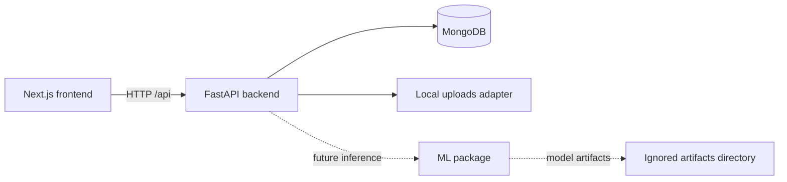

# Smart Wardrobe and Outfit Planner

A monorepo for a wardrobe and outfit-planning application. The existing Next.js
client is in `frontend/`; the asynchronous FastAPI API and MongoDB integration
are in `backend/`; future computer-vision and model-training code belongs in
`ml/`.

## Repository layout

```text
.
├── frontend/                 # Next.js App Router, React, TypeScript, Tailwind
├── backend/
│   ├── app/
│   │   ├── core/             # Settings, security primitives, MongoDB lifecycle
│   │   ├── models/            # MongoDB collection/document definitions
│   │   ├── routers/           # Versioned HTTP endpoints
│   │   ├── schemas/           # Pydantic request/response schemas
│   │   └── services/          # Application and integration services
│   ├── uploads/               # Local upload storage (git-ignored)
│   └── requirements.txt
└── ml/
    ├── artifacts/             # Generated model weights (git-ignored)
    └── src/wardrobe_ml/        # ML package boundary
```



## Phase 1: setup and run

### Prerequisites

- Node.js 20 or newer and npm
- Python 3.11 or newer
- MongoDB 6 or newer, running locally or at a configured URI

### Frontend

```powershell
cd frontend
npm install
npm run dev
```

Open <http://localhost:3000>. For validation, run `npm run typecheck` and
`npm run build` from `frontend/`.

### Backend

```powershell
cd backend
py -3.11 -m venv .venv
.\.venv\Scripts\Activate.ps1
python -m pip install -r requirements.txt
Copy-Item .env.example .env
uvicorn app.main:app --reload
```

Set `MONGODB_URI` and `JWT_SECRET_KEY` in `backend/.env` for your environment.
Create a unique signing key with
`python -c "import secrets; print(secrets.token_urlsafe(48))"` and set it as
`JWT_SECRET_KEY` in `backend/.env`. The backend refuses to start with a missing
or weak signing key. Set `AUTH_COOKIE_SECURE=true` when serving over HTTPS.
The API initializes the `users`, `clothing_items`, `outfits`, and `preferences`
collections during startup. API health and interactive docs are available at
<http://localhost:8000/api/health> and <http://localhost:8000/docs>.

### Frontend API configuration

`frontend/.env.example` defaults to `http://localhost:8000/api`. Copy it to
`frontend/.env.local` if the backend uses a different address. Authentication
uses an HTTP-only, SameSite=Lax session cookie; the JWT is not exposed to
browser JavaScript.

### Phase 2: authentication and preferences

- `POST /api/auth/register`, `POST /api/auth/login`, `POST /api/auth/logout`
- `GET /api/auth/me` and `GET`/`PUT /api/preferences` require the session cookie.
- Registration and login validate credentials; account passwords are bcrypt
  hashes, never stored in plaintext.
- Preferences store favorite/disliked colors, preferred styles, and optional
  fit notes per authenticated user.
- Open `/register` to create an account, then `/preferences` to set and save
  preferences. The wardrobe requires a signed-in account.

#### Quick authentication and preference test

With MongoDB and the backend running, this PowerShell smoke test registers a
throwaway account, persists preferences, then signs in using a separate cookie
session:

```powershell
$email = "wardrobe-$([guid]::NewGuid().ToString('N'))@example.com"
$credentials = @{ email = $email; password = "WardrobeTest123!" }
$body = $credentials | ConvertTo-Json
$session = [Microsoft.PowerShell.Commands.WebRequestSession]::new()
Invoke-RestMethod http://localhost:8000/api/auth/register -Method Post -ContentType "application/json" -Body $body -WebSession $session
$preferences = @{ favorite_colors = @("Navy", "Beige"); preferred_styles = @("casual", "formal"); disliked_colors = @("Neon green"); gender_fit_notes = "Relaxed fit" } | ConvertTo-Json
Invoke-RestMethod http://localhost:8000/api/preferences -Method Put -ContentType "application/json" -Body $preferences -WebSession $session
$loginSession = [Microsoft.PowerShell.Commands.WebRequestSession]::new()
Invoke-RestMethod http://localhost:8000/api/auth/login -Method Post -ContentType "application/json" -Body $body -WebSession $loginSession
Invoke-RestMethod http://localhost:8000/api/preferences -WebSession $loginSession
```

The final response should contain the saved colors, styles, and fit notes. The
same API calls can be performed in the frontend at `/register` and
`/preferences`.

### Phase 3: wardrobe management

- `GET`/`POST /api/wardrobe`, `PATCH`/`DELETE /api/wardrobe/{item_id}`, and
  `GET /api/wardrobe/{item_id}/image` all require the signed-in session cookie.
- `GET /api/wardrobe` accepts `skip` and `limit` parameters (1–100) for
  pagination; the frontend loads each page before applying client-side filters.
- Uploads accept JPEG, PNG, and WebP images up to 10 MB and 40 megapixels.
  The backend checks the decoded format, re-encodes the image to remove embedded
  metadata, and stores it under a generated filename in `backend/uploads/`.
- Image delivery checks item ownership; the uploads directory is not mounted
  as a public static directory.
- Clothing metadata includes category, subtype, dominant colors, season,
  occasion tags, notes, and creation time. MongoDB list queries are scoped to
  the account and sorted newest first.
- The wardrobe page supports category, type, season, occasion, multi-color, and
  added-date filters, metadata editing, and deletion. Saved outfit drafts remain
  in per-user browser storage.

#### Quick wardrobe test

1. Start the backend and frontend, register or sign in, and choose **Add a piece**.
2. Upload a JPEG, PNG, or WebP image up to 10 MB; enter a name, category, color,
   season, and optional occasion tags or notes; save the item.
3. Reload the page. The item and its image should still be present.
4. Filter by its category, color, and season; use the ellipsis to edit its
   metadata, then use the trash button to delete it.
5. Register a second account and sign in: the first account's wardrobe items and
   protected image URLs must not be visible to the second account.

### Phase 4: clothing classification

- The ML package defines a pretrained MobileNetV2 with a five-category head:
  `top`, `bottom`, `dress`, `outerwear`, and `footwear`.
- The baseline training script fine-tunes the head on Fashion-MNIST. It maps the
  dataset's clothing labels into the five wardrobe categories and excludes
  `Bag`, which is not part of this classifier's taxonomy. Fashion-MNIST is a
  small grayscale benchmark; this baseline is not a substitute for training on
  real wardrobe photographs.
- Training evaluates against Fashion-MNIST's official test split and writes
  `ml/artifacts/clothing_classifier_state.pth`,
  `ml/artifacts/clothing_classifier_metrics.json` (accuracy and confusion
  matrix), and `ml/artifacts/clothing_classifier_metadata.json`. These generated
  artifacts are local and git-ignored.
- Inference is provided by
  `wardrobe_ml.classifier.classify_image(image) -> {category, confidence}`.
  The authenticated `POST /api/classify` endpoint accepts a multipart `file`
  field and returns the predicted category and confidence. It returns `503`
  until trained weights are present rather than guessing with a random head.
- Selecting a new image in the wardrobe upload form calls the classifier and
  preselects its category. The category control remains editable so the user
  can correct the prediction before saving.

#### Train the baseline

From the repository root, using the backend environment:

```powershell
.\backend\.venv313\Scripts\python.exe .\ml\src\train_clothing_classifier.py
```

Training downloads Fashion-MNIST and the official pretrained MobileNetV2 weights
if they are not cached yet. For a quick smoke run on a smaller training subset:

```powershell
.\backend\.venv313\Scripts\python.exe .\ml\src\train_clothing_classifier.py --max-train-samples 3000 --epochs 1
```

Use the full default dataset run for reported baseline metrics. To retrain for
more epochs, pass `--epochs N`. The training script prints test accuracy and a
confusion matrix; the complete metrics are also written to the artifacts folder.

#### Quick classification test

1. Train the model as above and start MongoDB, the backend, and frontend.
2. Sign in, open **Wardrobe**, and choose **Add a piece**.
3. Select a clothing photo; the category suggestion and confidence should appear
   after classification. Change the category selector to correct the result,
   then save and verify the saved item uses the corrected category.
4. To call the API directly, send an authenticated multipart POST with `file`
   to `http://localhost:8000/api/classify`.

### Phase 5: clothing attributes and color extraction

- On wardrobe upload, the backend center-crops and scales the stored image for
  analysis, applies OpenCV GrabCut foreground segmentation with a safe crop
  fallback, and clusters foreground pixels with deterministic KMeans.
- Up to three dominant colors are stored as named colors and matching RGB hex
  values. Explicit colors supplied by the user take precedence; in that case
  detected hex values are not attached to the manually entered color names.
- The image-analysis result also stores a coarse pattern (`solid`, `striped`,
  `checked`, or `unknown`), an optional sleeve-length estimate for tops and
  outerwear, a broad subtype when available, and an attribute summary. These
  pattern/sleeve/type results are image heuristics, not a separately trained
  attribute model; unclear results stay unknown or unset.
- The wardrobe API returns the derived attributes, and item cards display the
  detected color swatches/hex values, pattern, sleeve estimate, and summary.
- Pattern or sleeve information is not fabricated as occasion tags; user-entered
  occasion tags remain unchanged.

#### Quick attribute test

1. Start the backend and frontend, sign in, and add an item with its category.
2. Leave colors blank to see the detected names and hex swatches on the saved
   item. Enter colors yourself to verify your names take precedence.
3. Inspect the item response or MongoDB document for `pattern`,
   `sleeve_length`, `sub_type`, `dominant_color_hex`, and `attribute_summary`.

### Quick checks

- Frontend: `npm run typecheck` from `frontend/`.
- Backend: `python -m compileall app` from `backend/`.
- API smoke test: with MongoDB running and the API started,
  `Invoke-RestMethod http://localhost:8000/api/health` should report `status: ok`
  and `database: ok`.

### Phase 6: outfit recommendation engine

- `POST /api/outfits/recommend` requires the signed-in session cookie.
- It reads the active wardrobe, applies occasion and weather constraints, and
  ranks top outfit combinations using a weighted score.
- Scoring combines compatibility by occasion, temperature/condition fit,
  user-preference boosts or penalties, and color harmony rules.
- Each recommendation includes a score and a breakdown of why it ranks highly.
- The recommendation logic is isolated in a service module and covered by
  unit tests for the scoring helpers.

## Phase 7: Gemini styling suggestions

- `POST /api/outfits/styling-tips` accepts an outfit summary, occasion, and
  weather context and returns a compact recommendation with styling guidance,
  accessory ideas, and the reason the outfit works.
- The service wraps the Gemini generation layer in a retryable, timeout-aware
  client and falls back to a deterministic local tip when the external API is
  unavailable or rate-limited.
- The API response is shaped to be lightweight for the frontend while still
  supporting the planner UI and saved outfit views.

### Styling tip test

```powershell
Invoke-RestMethod "http://localhost:8000/api/outfits/styling-tips" `
  -Method Post `
  -ContentType "application/json" `
  -Body '{"occasion":"formal","weather":{"temperature":22,"condition":"clear"},"items":[{"category":"top","name":"white shirt"},{"category":"bottom","name":"navy trousers"}]}'
```

## Phase 8: outfit customization and saved outfits

- Authenticated outfit CRUD endpoints manage saved looks, renaming, favorite
  toggling, and deletion.
- The frontend Outfit Planner supports swap-in alternatives for each item slot,
  allowing users to build custom combinations from the wardrobe before saving.
- Saved outfits are linked to the current user and remain isolated by account.

### Saved outfit smoke test

```powershell
$session = [Microsoft.PowerShell.Commands.WebRequestSession]::new()
Invoke-RestMethod http://localhost:8000/api/auth/login -Method Post -ContentType "application/json" -Body '{"email":"demo@example.com","password":"DemoPass123!"}' -WebSession $session
Invoke-RestMethod http://localhost:8000/api/outfits -Method Get -WebSession $session
```

## Phase 9: frontend polish

The application includes a polished landing experience, dashboard, wardrobe grid,
profile page, saved-outfits page, and planner workflow with loading states,
empty states, toast feedback, and mobile-responsive layouts.

### Frontend validation

```powershell
cd frontend
npm test
npm run build
```

## Phase 10: testing, deployment, and documentation

This phase secures project quality, operational readiness, and maintainability.

### Automated tests

```powershell
cd backend
.\.venv313\Scripts\python.exe -m pytest -q

cd ..\frontend
npm test
```

### Docker deployment

```powershell
cd .
# Start dependencies and services
docker compose up --build -d
```

This brings up:

- MongoDB on `localhost:27017`
- FastAPI backend on `localhost:8000`
- Next.js frontend on `localhost:3000`

Validate the system with:

```powershell
Invoke-RestMethod http://localhost:8000/api/health
curl http://localhost:3000
```

### Vercel + Render + MongoDB Atlas deployment

The recommended hosted setup deploys the Next.js app to Vercel, the FastAPI
service to Render, and stores MongoDB data in MongoDB Atlas. The Render
Blueprint is defined in `render.yaml`; its persistent disk stores uploaded
wardrobe images across service restarts and deploys.

1. Create an Atlas database and database user. Copy its connection string,
   replace the username, password, and database name, and allow Render's
   outbound connections in Atlas Network Access. Use a unique database
   password and URL-encode special characters in it.
2. Import this repository into Render as a Blueprint. Enter the Atlas URI when
   prompted for `MONGODB_URI`. The Blueprint creates a paid Starter web service,
   a generated JWT secret, and a 1 GB persistent upload disk mounted at
   `/var/data`. Keep `AUTH_COOKIE_SECURE=true`; do not commit secrets.
3. Wait for the Render service to become healthy. Copy its origin, for example
   `https://smart-wardrobe-api.onrender.com` (without `/api`), and verify
   `https://<render-service>/api/health` returns `{"status":"ok","database":"ok"}`.
4. Import the same repository into Vercel and set the project **Root Directory**
   to `frontend`. Add these environment variables for Production:
   - `NEXT_PUBLIC_API_URL=/api`
   - `WARDROBE_API_ORIGIN=https://<render-service>.onrender.com`
5. Deploy the Vercel project. `next.config.ts` proxies `/api/*` requests through
   the Next.js app to Render. This keeps authentication cookies same-origin in
   the browser and avoids exposing the backend URL to client-side JavaScript.
6. In Vercel, add the production URL to **Domains** if using a custom domain,
   then redeploy after changing environment variables. Test registration,
   sign-in, loading `/api/auth/me` through the app, and uploading an image.

The browser should call the Vercel origin for API requests; do not set
`NEXT_PUBLIC_API_URL` to the Render URL for this setup. The Render API's
`CORS_ORIGINS` is empty by default because browser traffic is same-origin via
the proxy. If calling the API directly from another browser origin, configure
that exact origin in Render and redeploy. The Render Starter plan is needed for
the persistent upload disk; changing to ephemeral storage can lose uploaded
images during redeploys. MongoDB Atlas remains the durable database.

### Root project documentation

The repository includes:

- `render.yaml` for the Render API service and persistent upload disk
- `backend/requirements.txt` for Python dependencies
- `docker-compose.yml` for local orchestration
- `frontend/Dockerfile` and `backend/Dockerfile` for containerized deployment
- `docs/project-report.md` with the project-report outline
- `docs/api-summary.md` with endpoint summary and quick reference
- `docs/screenshots.md` with placeholder image locations for product screenshots

### Project report outline

See `docs/project-report.md` for a structured outline with:

- Abstract
- Literature survey
- System design
- Data flow diagrams (DFDs)
- ER diagram and schema overview
- Results and evaluation
- Limitations
- Future scope

## Final project status

The monorepo includes a full multi-phase wardrobe planning workflow: authentication,
preferences, wardrobe CRUD, classification, attribute extraction, outfit scoring,
Gemini styling, saved outfits, polished frontend UX, tests, Docker deployment,
and project documentation.
