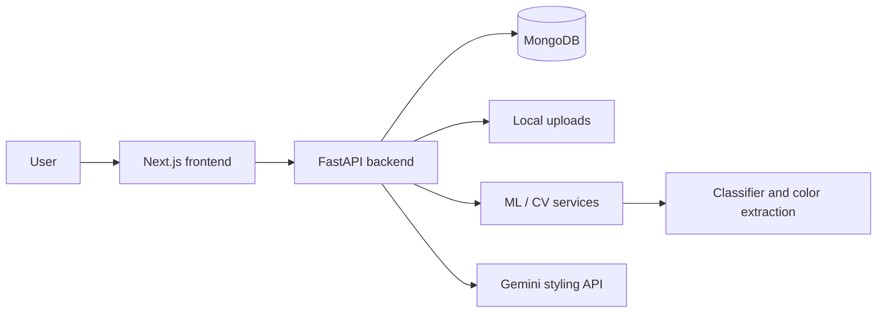
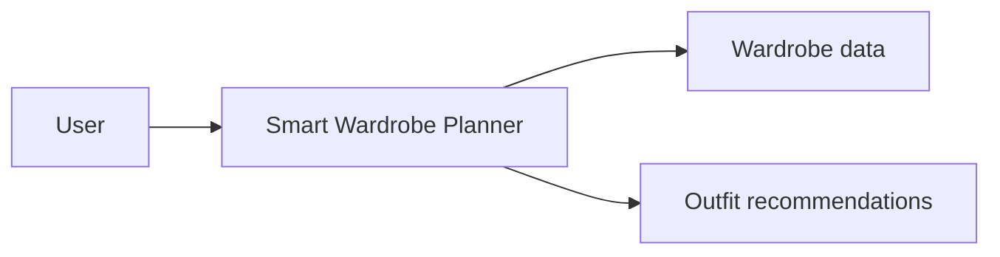
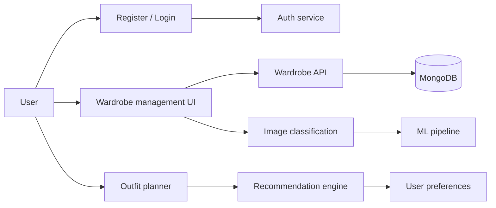
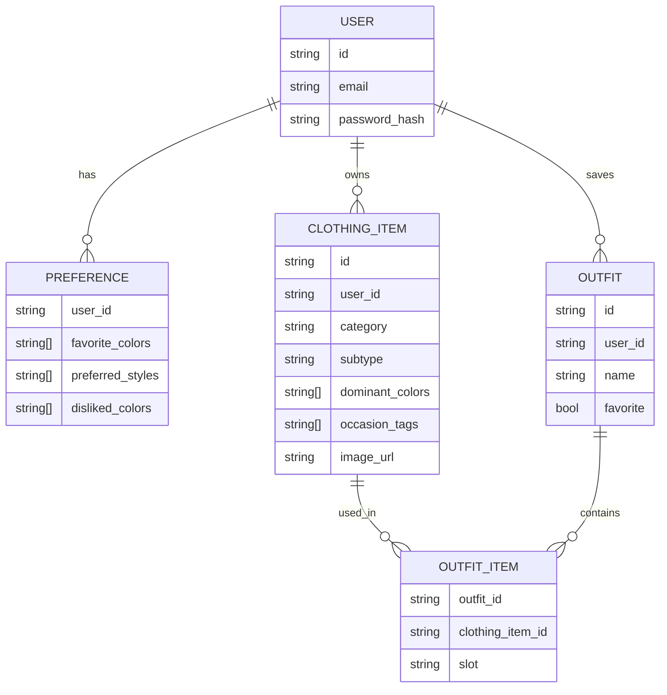

# Project report outline

## 1. Abstract

Smart Wardrobe and Outfit Planner is a full-stack wardrobe assistant that helps users organize clothing items, analyze their wardrobe visually, and generate outfit recommendations by combining user preferences, weather, occasion, and color harmony rules. The project combines a Next.js frontend, FastAPI backend, MongoDB persistence, and a Python ML pipeline.

## 2. Literature survey

- Fashion recommendation systems and digital wardrobe management
- Clothing classification with MobileNetV2 and transfer learning
- Dominant color extraction using OpenCV and K-means clustering
- Rule-based outfit compatibility and personalization techniques
- Generative AI support for styling suggestions and accessory ideas

## 3. System design

### Architecture overview

### Design decisions

- Use a monorepo for clear separation of frontend, backend, and ML code.
- Keep ML inference in dedicated service modules so the algorithm can be swapped or tested independently.
- Secure per-user access with JWT auth and MongoDB ownership checks.
- Store wardrobe media in a local upload directory to allow future cloud-backed storage.

## 4. Data flow diagrams (DFDs)

### Level 0

### Level 1

## 5. ER diagram and schema overview

## 6. Results and evaluation

- Backend test coverage includes recommendation, styling, classification, and route-level checks.
- Frontend tests validate core UI behavior and toast flows.
- The project demonstrates end-to-end wardrobe creation, analysis, and outfit scoring.
- Current performance is suitable for a prototype and can be upgraded with larger datasets and production hosting.

## 7. Limitations

- Fashion-MNIST is a small benchmark and is not representative of real-world wardrobe imagery.
- Local file storage is convenient for development but does not scale to multi-instance production deployments.
- Rule-based outfit scoring is interpretable but cannot fully capture human taste or style nuance.
- Gemini responses depend on external API availability and cost constraints.

## 8. Future scope

- Replace local storage with cloud storage and a managed object bucket.
- Train a custom clothing classifier on a real wardrobe dataset.
- Add user feedback loops to improve recommendation quality.
- Support multi-user social sharing and outfit trend analytics.
- Add advanced personalization, seasonal intelligence, and inventory forecasting.
